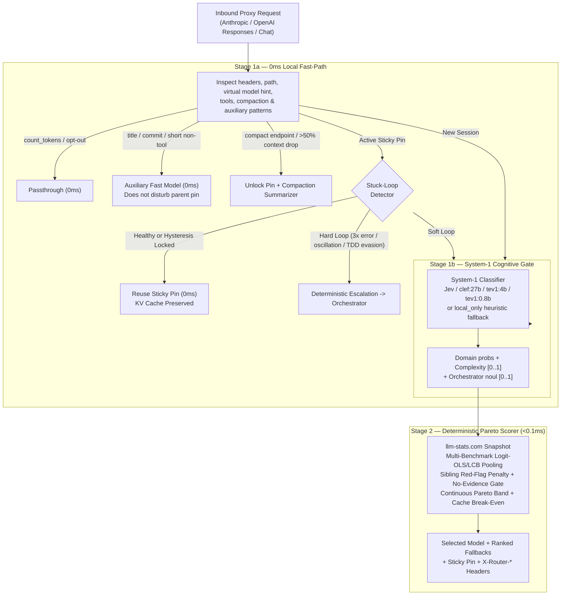

# s1gate

[](https://www.npmjs.com/package/@albifhrzq/s1gate)
[](https://github.com/albifhrzq/s1gate/actions/workflows/ci.yml)
[](./LICENSE)

**System-1 Cognitive Model Routing Engine** for agentic coding proxies — combining fast System-1 task classification (`Jev` / `clef:27b` / `tev1:4b` / `tev1:0.8b`) with deterministic [`llm-stats.com`](https://llm-stats.com) benchmark scoring and KV-cache session protection.

---

## Why `s1gate`?

Coding agents (Claude Code, Codex, OpenCode, Aider, Cursor) hit three expensive failure modes when wired to multi-model proxies:

1. **Flagship Waste** — Running a $4–$8/MTok flagship model (Opus / Fable / frontier reasoning models) on 100% of routine edits, bash lookups, commit summaries, and subagents burns 60–90% of budget unnecessarily.
2. **Manual `/model` Friction** — Switching models manually across 50+ upstream providers interrupts flow and leads developers to leave a flagship model pinned all day.
3. **The KV Cache Trap** — Naive per-turn routers switch models mid-session (e.g., bouncing between cheap and flagship models turn-by-turn). In real agentic coding sessions, **85–95% of input tokens are prompt cache reads**. Invalidating the KV cache mid-session can make a "smart router" **more expensive** than staying on a single model.

`s1gate` solves all three by combining a **0ms local fast-path + sticky cache pinning + stuck-loop escalation ratchet** with a **System-1 cognitive classifier** and a **deterministic multi-benchmark Pareto scorer**.

---

## 2-Stage Architecture



### Key Safeguards in Stage 2

- **Multi-Benchmark Evidence Pooling (Logit-OLS + LCB)** — Combines direct benchmark scores with statistically bridged fallback benchmarks (`rAdj >= 0.30`) penalized by lower confidence bounds.
- **Sibling Red-Flag Penalty** — Catches single-benchmark cherry-picking when a model scores dramatically worse on sibling coding/terminal benchmarks.
- **No-Evidence Gate** — Excludes unverified models from `balanced` and `quality` profiles whenever verified candidates exist.
- **Continuous Pareto Banding** — Selects the lowest cache-adjusted effective cost within `[Qmax - ΔQ(profile, role, complexity), Qmax]`, preferring higher quality within a 12% cost tie-band.

---

## Quickstart: Embed as an npm Library (~25-Line Proxy Adapter)

Install `s1gate` in your TypeScript / Node 20+ / Bun proxy (e.g. **OpenCodex (`ocx`)**, **9Router**, or a custom gateway):

```bash
npm install @albifhrzq/s1gate
```

```ts
import { createS1Gate } from "@albifhrzq/s1gate";

const router = createS1Gate({
  defaultProfile: "balanced", // "frugal" | "balanced" | "quality"
  triggerModels: ["s1gate", "auto"], // optional: only route requests targeting these virtual IDs
  systemOne: {
    endpointUrl: process.env.S1GATE_SYSTEMONE_URL ?? "https://ollama.com/v1/systemone",
    model: process.env.S1GATE_SYSTEMONE_MODEL ?? "clef:27b",
    apiKey: process.env.OLLAMA_API_KEY,
  },
});

export async function resolveUpstreamModel(req: {
  protocol: "anthropic_messages" | "openai_responses" | "openai_chat";
  path: string;
  headers: Record<string, string | undefined>;
  body: Record<string, unknown>;
  availableModels: string[];
}) {
  const decision = await router.route({
    ...req,
    harness: "claude_code",
  });
  return {
    model: decision.selectedModel,
    fallbacks: decision.rankedFallbacks,
    headers: decision.headers, // X-Router-Model, X-Router-Domain, X-Router-Cache-Pinned, ...
  };
}
```

Users can also override profile or role inline via virtual model hints such as `s1gate:frugal`, `s1gate:quality`, or `s1gate:fast`.

---

## Zero-Fork Drop-in HTTP Bridge

Run `s1gate` as a standalone local sidecar without modifying your proxy's language runtime:

```bash
npx @albifhrzq/s1gate serve \
  --port 8787 \
  --profile balanced \
  --systemone-url https://ollama.com/v1/systemone \
  --systemone-model clef:27b
```

Or run completely offline with zero outbound classifier traffic:

```bash
npx @albifhrzq/s1gate serve --port 8787 --local-only
```

### Endpoints

| Method & Path | Intended Consumer | Description |
| --- | --- | --- |
| `POST /v1/systemone` | OpenCodex (`ocx`), 9Router, System-1 clients | Drop-in System-1 choice endpoint; maps `questions.*.criteria` keys to candidate models, parses structured `state` signals (`estimated_tokens`, `has_image`, `tool_history`) and advisory quota percentages from `criteria`, and returns ranked `choice` + `probabilities` + `X-Router-*` headers. |
| `POST /v1/route` | Go / Python / Rust / custom proxies | Full `s1gate` routing API accepting `{ protocol, headers, body, availableModels, estimatedContextTokens?, profile?, harness?, quotaUtilization? }` and returning the full `S1GateDecision`. |
| `GET /health` | Healthchecks & monitoring | Returns engine status, bundled `llm-stats.com` model count, domain count, and live routing stats. |

#### Context Window & Signal Headers

- **Request header `X-S1Gate-Context-Tokens`** (or `estimatedContextTokens` on `POST /v1/route` / `state.signals.estimated_tokens` on `POST /v1/systemone`): caller-provided session token count used when the proxy trims `body.messages` or already counted context tokens. Enforces 90% context-window headroom on both sticky-pin invalidation and Stage 2 model selection.
- **Response header `X-Router-Context-Window`**: emitted whenever the selected model resolves to a candidate with a positive context window (e.g. `1000000`), alongside `X-Router-Model`, `X-Router-Action`, `X-Router-Role`, and `X-Router-Benchmark-Source`.

### Environment Variables

| Variable | Purpose | Default |
| --- | --- | --- |
| `S1GATE_PORT` | HTTP bridge listen port | `8787` |
| `S1GATE_HOST` | HTTP bridge bind host | `127.0.0.1` |
| `S1GATE_PROFILE` | Default budget profile (`frugal` \| `balanced` \| `quality`) | `balanced` |
| `S1GATE_SYSTEMONE_URL` | Upstream System-1 classification endpoint | _(heuristic fallback)_ |
| `S1GATE_SYSTEMONE_MODEL` | System-1 model identifier | `jev-latest` |
| `S1GATE_API_KEY` | Bearer token (falls back to `TYPESAFE_API_KEY`, `JEV_API_KEY`, `OLLAMA_API_KEY`) | _(none)_ |

---

## System-1 Backends

`s1gate` works with any System-1 `/v1/systemone` endpoint and includes built-in backend calibration & circuit-breaker fail-open protection:

| Backend | Model ID | Endpoint | Notes |
| --- | --- | --- | --- |
| **TypeSafe Jev** | `jev-latest` | TypeSafe System-1 API | Hosted low-latency System-1 classifier. |
| **Ollama Cloud** | `clef:27b` | `https://ollama.com/v1/systemone` | Strong multi-domain accuracy (~650ms p50). |
| **Local Ollama (4B)** | `tev1:4b` | `http://127.0.0.1:11434/v1/systemone` | Private local inference with strong coding calibration. |
| **Local Ollama (0.8B)** | `tev1:0.8b` | `http://127.0.0.1:11434/v1/systemone` | Ultra-fast local inference; auto-applies `-0.15` complexity calibration offset. |
| **Cloudflare Workers AI** | `clef` | Workers AI System-1 endpoint | Edge deployment with low regional latency. |
| **Zero-Network Local** | `local_only` | _(in-process)_ | Set `privacyMode: "local_only"` or `--local-only` for 0-network heuristic classification. |

All external System-1 calls only receive a **redacted routing envelope** (fenced code blocks, API tokens/JWTs, emails, IPs, and URLs are stripped before egress) and fail open to the local heuristic classifier on timeout, HTTP error, or open circuit breaker.

---

## Offline Counterfactual Replay & Inspection

Replay recorded sessions against your proxy's live model catalog before enabling live routing:

```bash
npx @albifhrzq/s1gate replay \
  --signals ./benchmarks/systemone-signals-257-sessions.json \
  --ocx-models ./ocx/models.json \
  --claude-dir ~/.claude/projects \
  --backend clef27b
```

Output compares **Always Flagship**, **Actual (logged)**, **Naive Per-Turn (cache bust)**, and **`s1gate` Quality / Balanced / Frugal** with cost deltas and top model mixes. Add `--json` for machine-readable CI output.

### Sample Counterfactual Replay Results

Evaluated offline across **257 real coding-agent sessions** (**15,991 turns**, **92.3% prompt-cache read share**, 73-model catalog, `clef:27b` System-1 signals, `llm-stats.com` pricing & benchmarks):

| Strategy | Total Cost | vs Always Flagship | vs Actual Logged |
| --- | ---: | ---: | ---: |
| Always Flagship | `$2,282.88` | baseline | `+33.6%` |
| Actual (logged) | `$1,709.27` | `-25.1%` | baseline |
| Naive Per-Turn (cache bust) | `$1,602.43` | `-29.8%` | `-6.3%` |
| **`s1gate` Balanced** | **`$1,038.26`** | **`-54.5%`** | **`-39.3%`** |
| **`s1gate` Frugal** | **`$370.09`** | **`-83.8%`** | **`-78.3%`** |

Inspect how `s1gate` ranks candidates for any domain and complexity:

```bash
npx @albifhrzq/s1gate inspect \
  --domain software_engineering \
  --complexity 0.55 \
  --profile balanced \
  --role specialist
```

---

## Benchmark Data Attribution

All bundled benchmark scores and model pricing metadata in `data/snapshot.json` are sourced from **[llm-stats.com](https://llm-stats.com)** (ZeroEval).

- Every routing decision includes the `X-Router-Benchmark-Source: llm-stats.com` response header.
- Refresh the snapshot locally from `llm-stats.com` using `npm run sync:live` (or from an offline mirror with `npm run sync:offline`).

---

## License

[MIT](./LICENSE)
