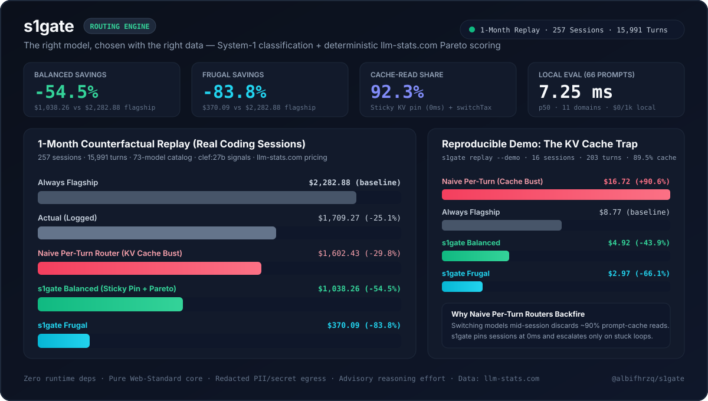
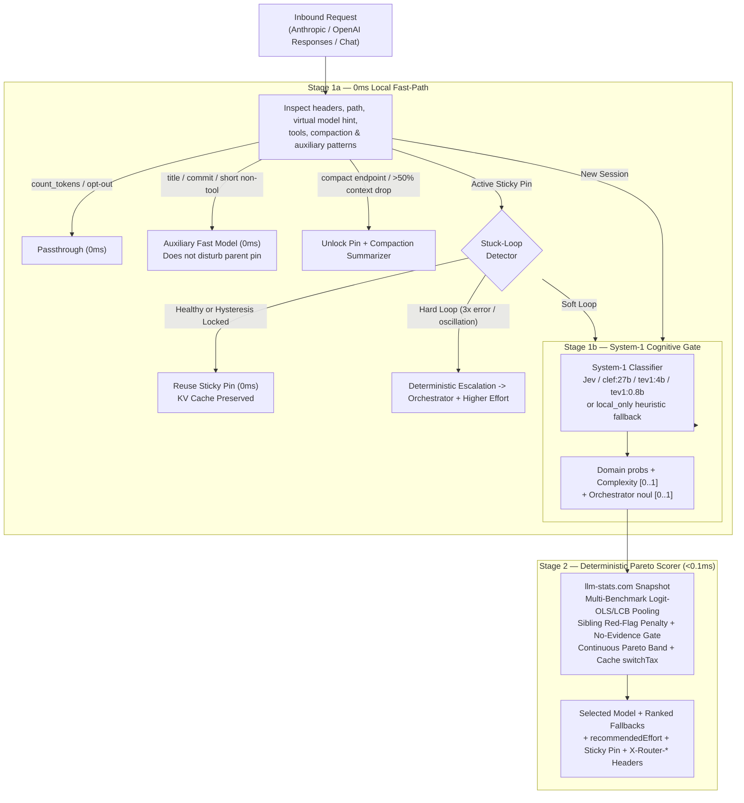

# s1gate

[](https://www.npmjs.com/package/@albifhrzq/s1gate)
[](https://github.com/albifhrzq/s1gate/actions/workflows/ci.yml)
[](./LICENSE)

**The right model, chosen with the right data.**

`s1gate` is a proxy-agnostic, zero-dependency **System-1 Cognitive Model Routing Engine** for AI coding agents and LLM gateways. Instead of asking a black-box router to guess model names from memory—or switching models every turn and accidentally busting your prompt cache—`s1gate` separates routing into two auditable stages:

1. **Fast System-1 task classification** (`Jev` / `clef:27b` / `tev1:4b` / `tev1:0.8b` or zero-network `--local-only` fallback) on a **redacted routing envelope** (code blocks, secrets, and PII stripped before egress).
2. **Deterministic multi-benchmark & cache-cost Pareto scoring** backed by [`llm-stats.com`](https://llm-stats.com), sticky KV-cache session pinning, stuck-loop escalation, and advisory `recommendedEffort`.



---

## By the Numbers

### 1. 1-Month Real Coding-Agent Replay (257 Sessions · 15,991 Turns · 92.3% Cache-Read Share)

Evaluated offline against a 73-model catalog using `clef:27b` System-1 signals and [`llm-stats.com`](https://llm-stats.com) pricing/benchmarks:

| Strategy | Total Cost | vs Always Flagship | vs Actual Logged |
| --- | ---: | ---: | ---: |
| Always Flagship | `$2,282.88` | baseline | `+33.6%` |
| Actual (logged) | `$1,709.27` | `-25.1%` | baseline |
| Naive Per-Turn (cache bust) | `$1,602.43` | `-29.8%` | `-6.3%` |
| **`s1gate` Balanced** | **`$1,038.26`** | **`-54.5%`** | **`-39.3%`** |
| **`s1gate` Frugal** | **`$370.09`** | **`-83.8%`** | **`-78.3%`** |

### 2. Reproducible Public Benchmarks (Run Yourself in 5 Seconds, Zero API Keys)

| Benchmark | Command | Key Verified Results |
| --- | --- | --- |
| **Public Multi-Turn Demo Replay** *(16 sessions · 203 turns · 89.5% cache read)* | `npx @albifhrzq/s1gate replay --demo` | Always Flagship `$8.77` · **Naive Per-Turn `$16.72` (`+90.6%` KV-cache bust!)** · **`s1gate` Balanced `$4.92` (`-43.9%`)** · **Frugal `$2.97` (`-66.1%`)** |
| **Public Labelled Eval** *(66 prompts · 11 domains · `--local-only`)* | `npx @albifhrzq/s1gate eval --local-only` | `100.0%` domain · `100.0%` role · `98.5%` complexity band · **`7.25 ms` p50** · **`$0.00 / 1k` local** *(run with `--systemone-url` for live System-1 evaluation)* |

---

## Why `s1gate`?

Multi-model coding agents (Claude Code, Codex, OpenCode, Aider, Cursor) and production LLM apps hit three structural routing problems:

1. **Guesswork Routing** — Asking a decision model to pick raw model names from training weights breaks on newly released or custom models and cannot be audited. `s1gate` lets System-1 classify the *task* while Stage 2 scores candidate models deterministically from benchmark evidence.
2. **The KV Cache Trap** — In real coding-agent sessions, **85–95% of input tokens are prompt-cache reads**. Switching models mid-session discards that cache and can make a naive per-turn router **more expensive** than staying on a single flagship. `s1gate` pins sessions at 0ms, prices cache-miss `switchTax`, and escalates only when a stuck loop is detected.
3. **Egress Privacy & Escalation Blindness** — Raw prompts often contain source code, API tokens, or PII. `s1gate` scrubs code blocks, secrets, and PII before calling any external classifier, and monitors agent tool loops to escalate automatically to an orchestrator model (and higher `recommendedEffort`) when a smaller model gets stuck.

---

## 2-Stage Architecture



### Key Safeguards in Stage 2

- **Multi-Benchmark Evidence Pooling (Logit-OLS + LCB)** — Combines direct benchmark scores with statistically bridged fallback benchmarks (`rAdj >= 0.30`) penalized by lower confidence bounds.
- **Sibling Red-Flag Penalty** — Catches single-benchmark cherry-picking when a model scores dramatically worse on sibling coding/terminal benchmarks.
- **No-Evidence & Pricing Gates** — Excludes unverified or unpriced (`$0`) models from `balanced` and `quality` profiles whenever verified priced candidates exist.
- **Continuous Pareto Banding** — Selects the lowest cache-adjusted effective cost within `[Qmax - ΔQ(profile, role, complexity), Qmax]`, preferring higher quality within a 12% cost tie-band.
- **Advisory Reasoning Effort (`recommendedEffort`)** — Emits deterministic, KV-cache-safe effort guidance (`none` | `low` | `medium` | `high` | `max`) and `X-Router-Effort` headers (bumping monotonically on escalation, preserving pinned effort on `pin_reuse`).

---

## Quickstart

```bash
npm install @albifhrzq/s1gate
```

### Option 1: Official SDK Integration (`createRoutingFetch`, 0 Dependencies, Edge/Node/Bun)

Plug `s1gate` directly into the official OpenAI, Anthropic, or OpenRouter SDK without running a proxy server—streaming, auth headers, and retries remain 100% handled by the official SDK:

```ts
import OpenAI from "openai";
import { createS1Gate, createRoutingFetch } from "@albifhrzq/s1gate";

const engine = createS1Gate({
  defaultProfile: "balanced", // "frugal" | "balanced" | "quality"
  privacyMode: "local_only",  // or configure `systemOne` for Jev / clef / tev1
});

const client = new OpenAI({
  apiKey: process.env.OPENROUTER_API_KEY,
  baseURL: "https://openrouter.ai/api/v1",
  fetch: createRoutingFetch(engine, {
    availableModels: [
      "anthropic/claude-opus-4.6",
      "anthropic/claude-sonnet-4.6",
      "anthropic/claude-haiku-4.5",
      "openai/gpt-5.4",
      "deepseek/deepseek-chat",
    ],
    applyEffort: true, // optional: applies reasoning_effort on OpenAI Chat/Responses
    onDecision: (d) => console.log(d.selectedModel, d.recommendedEffort, d.action),
  }),
});
```

### Option 2: Embed in Any Custom Gateway or Proxy (`createS1Gate`)

Works in Node 20+, Bun, Deno, Cloudflare Workers, and Vercel Edge (`@albifhrzq/s1gate/core` has zero `node:*` imports):

```ts
import { createS1Gate } from "@albifhrzq/s1gate/core";

const router = createS1Gate({
  defaultProfile: "balanced",
  triggerModels: ["s1gate", "auto"], // optional virtual-model allowlist
  systemOne: {
    endpointUrl: process.env.S1GATE_SYSTEMONE_URL ?? "https://ollama.com/v1/systemone",
    model: process.env.S1GATE_SYSTEMONE_MODEL ?? "clef:27b",
    apiKey: process.env.OLLAMA_API_KEY,
  },
});

export async function resolveUpstreamModel(req: {
  protocol: "anthropic_messages" | "openai_responses" | "openai_chat";
  path: string;
  headers: Record<string, string | undefined>;
  body: Record<string, unknown>;
  availableModels: string[];
}) {
  const decision = await router.route({ ...req, harness: "claude_code" });
  return {
    model: decision.selectedModel,
    effort: decision.recommendedEffort,
    fallbacks: decision.rankedFallbacks,
    headers: decision.headers, // X-Router-Model, X-Router-Effort, X-Router-Domain, ...
  };
}
```

Users can also override profile or role inline via virtual model hints such as `s1gate:frugal`, `s1gate:quality`, or `s1gate:fast`.

---

## Zero-Fork Drop-in HTTP Bridge (`s1gate serve`)

Run `s1gate` as a standalone local JSON decision sidecar behind LiteLLM, OpenCodex (`ocx`), 9Router, Bifrost, or any Go/Python/Rust gateway:

```bash
npx @albifhrzq/s1gate serve \
  --port 8787 \
  --profile balanced \
  --systemone-url https://ollama.com/v1/systemone \
  --systemone-model clef:27b
```

Or run completely offline with zero outbound classifier traffic:

```bash
npx @albifhrzq/s1gate serve --port 8787 --local-only
```

### Endpoints

| Method & Path | Intended Consumer | Description |
| --- | --- | --- |
| `POST /v1/route` | LiteLLM / Go / Python / Rust / custom gateways | Full `s1gate` routing API accepting `{ protocol, headers, body, availableModels, estimatedContextTokens?, profile?, harness?, quotaUtilization? }` and returning the full `S1GateDecision` + `X-Router-*` headers. |
| `POST /v1/systemone` | OpenCodex (`ocx`), 9Router, System-1 clients | Drop-in System-1 choice endpoint; maps `questions.*.criteria` keys to candidate models, parses optional structured `state` signals (`estimated_tokens`, `has_image`, `tool_history`) and advisory quota percentages, and returns ranked `choice` + `probabilities` + `s1gate` metadata (`action`, `domain`, `role`, `cachePinned`, `recommendedEffort`). |
| `GET /health` | Healthchecks & monitoring | Returns engine status, bundled `llm-stats.com` model count, domain count, and live routing stats. |

#### Context Window & Signal Headers

- **Request header `X-S1Gate-Context-Tokens`** (or `estimatedContextTokens` on `POST /v1/route` / `state.signals.estimated_tokens` on `POST /v1/systemone`): caller-provided session token count enforcing 90% context-window headroom on both sticky-pin invalidation and Stage 2 eligibility.
- **Response headers**: `X-Router-Model`, `X-Router-Effort`, `X-Router-Action`, `X-Router-Role`, `X-Router-Profile`, `X-Router-Cache-Pinned`, `X-Router-Context-Window`, `X-Router-Domain`, `X-Router-Complexity`, `X-Router-Estimated-Savings-Pct`, and `X-Router-Benchmark-Source: llm-stats.com`.

### Environment Variables

| Variable | Purpose | Default |
| --- | --- | --- |
| `S1GATE_PORT` | HTTP bridge listen port | `8787` |
| `S1GATE_HOST` | HTTP bridge bind host | `127.0.0.1` |
| `S1GATE_PROFILE` | Default budget profile (`frugal` \| `balanced` \| `quality`) | `balanced` |
| `S1GATE_SYSTEMONE_URL` | Upstream System-1 classification endpoint | _(heuristic fallback)_ |
| `S1GATE_SYSTEMONE_MODEL` | System-1 model identifier | `jev-latest` |
| `S1GATE_API_KEY` | Bearer token (falls back to `TYPESAFE_API_KEY`, `JEV_API_KEY`, `OLLAMA_API_KEY`) | _(none)_ |

---

## System-1 Backends

`s1gate` works with any System-1 `/v1/systemone` endpoint and includes built-in backend calibration & circuit-breaker fail-open protection:

| Backend | Model ID | Endpoint | Notes |
| --- | --- | --- | --- |
| **TypeSafe Jev** | `jev-latest` | TypeSafe System-1 API | Hosted low-latency System-1 classifier. |
| **Ollama Cloud** | `clef:27b` | `https://ollama.com/v1/systemone` | Strong multi-domain accuracy (~650ms p50). |
| **Local Ollama (4B)** | `tev1:4b` | `http://127.0.0.1:11434/v1/systemone` | Private local inference with strong coding calibration. |
| **Local Ollama (0.8B)** | `tev1:0.8b` | `http://127.0.0.1:11434/v1/systemone` | Ultra-fast local inference; auto-applies `-0.15` complexity calibration offset. |
| **Cloudflare Workers AI** | `clef` | Workers AI System-1 endpoint | Edge deployment with low regional latency. |
| **Zero-Network Local** | `local_only` | _(in-process)_ | Set `privacyMode: "local_only"` or `--local-only` for 0-network heuristic classification. |

All external System-1 calls only receive a **redacted routing envelope** (fenced code blocks, API tokens/JWTs, emails, IPs, and URLs are stripped before egress) and fail open to the local heuristic classifier on timeout, HTTP error, or open circuit breaker.

---

## CLI Evaluation, Replay & Inspection

Run the bundled 66-prompt public evaluation suite offline or against any live System-1 backend:

```bash
# Zero-network local heuristic baseline
npx @albifhrzq/s1gate eval --local-only

# Live evaluation against a System-1 endpoint (markdown output for reports)
npx @albifhrzq/s1gate eval \
  --systemone-url https://ollama.com/v1/systemone \
  --systemone-model clef:27b \
  --markdown
```

Run the bundled 16-session multi-turn demo replay (or pass your own signals and `--models-file`):

```bash
# Bundled reproducible demo
npx @albifhrzq/s1gate replay --demo

# Replay your own recorded sessions
npx @albifhrzq/s1gate replay \
  --signals ./my-signals.json \
  --models-file ./models.json \
  --backend clef27b
```

Inspect how `s1gate` ranks candidates for any domain and complexity:

```bash
npx @albifhrzq/s1gate inspect \
  --domain software_engineering \
  --complexity 0.55 \
  --profile balanced \
  --role specialist
```

---

## Limitations & Trade-Offs

- **Benchmark snapshot freshness:** Stage 2 quality & pricing rely on `data/snapshot.json` (sourced from [`llm-stats.com`](https://llm-stats.com)). Newly released models not yet in the snapshot are treated as unverified and excluded from `balanced`/`quality` by the No-Evidence Gate unless overridden via `modelOverrides` or refreshed via `npm run sync:live`.
- **Public benchmarks vs. real-world agentic feel:** Public benchmarks are a strong objective baseline (hardened here with Logit-OLS/LCB bridging and Sibling Red-Flag penalties), but they do not capture every nuance of tool-use reliability or non-English prompts.
- **Local heuristic vs. live System-1:** `--local-only` uses deterministic keyword heuristics; the 100% domain score on the curated 66-prompt eval reflects clean technical vocabulary—use a live System-1 model (`jev-latest`, `clef:27b`, or local `tev1:4b`) for ambiguous real-world prompts.
- **Advisory effort only:** `recommendedEffort` is emitted as an optional advisory signal; host gateways/SDKs remain responsible for mapping or ignoring effort tiers for non-reasoning models.

---

## Benchmark Data Attribution & Contributing

- All bundled benchmark scores and model pricing metadata in `data/snapshot.json` are sourced from **[llm-stats.com](https://llm-stats.com)** (ZeroEval). Every routing decision emits `X-Router-Benchmark-Source: llm-stats.com`.
- Contributions are welcome—see [CONTRIBUTING.md](./CONTRIBUTING.md), [SECURITY.md](./SECURITY.md), and [CHANGELOG.md](./CHANGELOG.md).

## License

[MIT](./LICENSE)
